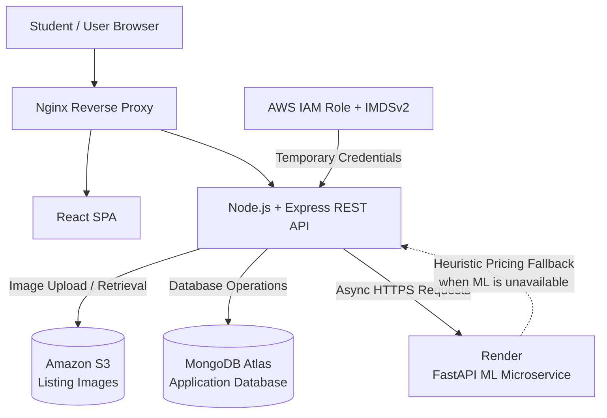
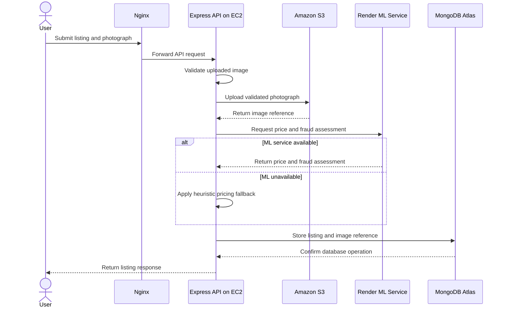

# Campus Marketplace
### Multi-Cloud Deployment and Architecture of a Secure and Scalable Peer-to-Peer Academic Platform

<p align="center">
  A campus-exclusive marketplace that enables verified students to buy, sell, lend and borrow academic and hostel essentials through a decoupled multi-cloud architecture.
</p>

<p align="center">
  
  
  
  
  
  
</p>

---

## 1. Project Overview

Campus Marketplace is a campus-exclusive peer-to-peer web platform designed to simplify the buying, selling, lending and borrowing of academic and hostel-related items among verified students.

Traditional campus transactions often take place through WhatsApp groups, Telegram channels and notice boards. These platforms lack institutional verification, structured listings, reliable image storage and mechanisms for identifying potentially fraudulent listings.

Campus Marketplace addresses these challenges through a centralized marketplace supported by cloud infrastructure and machine-learning-based assessment.

The primary focus of this project is the design, implementation and verification of a **decoupled multi-cloud deployment architecture**, using Amazon Web Services (AWS), MongoDB Atlas and Render.

Each application component is deployed independently according to its workload and infrastructure requirements.

## 2. Key Features

- **Campus-Based Authentication:** Access restricted to approved institutional email domains and Google sign-in.
- **Peer-to-Peer Marketplace:** Supports buying, selling, lending and borrowing academic and hostel essentials.
- **Machine Learning-Based Price Estimation:** Estimates fair listing prices using a gradient-boosting regression model.
- **Fraud Risk Detection:** Identifies potentially suspicious listings using Isolation Forest anomaly detection.
- **Explainable Fraud Scoring:** Provides risk factors to help administrators understand flagged listings.
- **Cloud-Based Image Storage:** Stores validated listing photographs in Amazon S3.
- **Managed Database:** Maintains users, listings, transactions, messages and audit records in MongoDB Atlas.
- **Secure AWS Access:** Uses IAM roles and IMDSv2 for temporary AWS credentials without storing permanent access keys.
- **Audit Logging:** Records security-sensitive administrative activities.
- **Resilient ML Integration:** Uses heuristic pricing when the independent ML service is unavailable.
- **Location Privacy:** Encrypts exact coordinates and exposes approximate geohash-based locations.

## 3. System Architecture

Campus Marketplace follows a decoupled multi-cloud architecture in which the frontend, transactional backend, database, object storage and machine-learning service operate as separate components.

### High-Level Architecture Diagram



### Architecture Components

| Component | Technology | Responsibility |
|---|---|---|
| Frontend | React | User interface and marketplace interaction |
| Web Server | Nginx | Reverse proxy and frontend delivery |
| Backend | Node.js, Express.js | REST API and transactional operations |
| Compute | Amazon EC2 | Hosts the frontend and backend |
| Object Storage | Amazon S3 | Stores listing photographs |
| Identity Management | AWS IAM, IMDSv2 | Secure temporary AWS credentials |
| Database | MongoDB Atlas | Persistent application data |
| ML Service | Python, FastAPI | Price estimation and fraud scoring |
| ML Hosting | Render | Independent ML service deployment |

## 4. Technology Stack

| Category | Technologies |
|---|---|
| Frontend | React 19, JavaScript |
| Backend | Node.js 20 LTS, Express.js 4 |
| Database | MongoDB Atlas |
| Cloud Provider | Amazon Web Services |
| Compute | AWS EC2 |
| Object Storage | Amazon S3 |
| Access Management | AWS IAM, IMDSv2 |
| Reverse Proxy | Nginx 1.24+ |
| Machine Learning | Python 3.11, Scikit-learn |
| ML Framework | FastAPI, Uvicorn |
| ML Deployment | Render |
| Operating System | Ubuntu 24.04 LTS |
| Version Control | Git, GitHub |

## 5. Cloud Infrastructure and Services

The application uses three independent cloud providers, with each service handling a specific responsibility.

### 5.1 Amazon EC2 – Infrastructure as a Service (IaaS)

Amazon EC2 hosts the main web application and transactional backend.

**Configuration:**
- Cloud Provider: Amazon Web Services
- Region: Asia Pacific (Sydney)
- Region Code: `ap-southeast-2`
- Operating System: Ubuntu 24.04 LTS
- Runtime: Node.js 20 LTS
- Web Server: Nginx 1.24 or later

**Responsibilities:**
- Hosts the React production build.
- Runs the Express.js REST API.
- Handles authentication and application requests.
- Coordinates communication with MongoDB Atlas, Amazon S3 and Render.

### 5.2 Amazon S3 – Object Storage

Amazon S3 is used to store listing photographs separately from the application database.

**Configuration:**
- Bucket Name: `campus-marketplace-cloud-762049038007`
- Region: `ap-southeast-2`

**Implementation:**
- Validates uploaded files using file magic bytes.
- Supports JPEG, PNG and WebP images.
- Stores images as S3 objects.
- Saves image references instead of binary image data in MongoDB.
- Supports direct S3 URLs and an optional Express streaming route.

This reduces database document sizes and separates media storage from transactional data.

### 5.3 AWS IAM and IMDSv2 – Identity and Access Management

The EC2 instance accesses Amazon S3 through an attached IAM role.

- An IAM role is attached to the EC2 instance using an instance profile.
- IMDSv2 provides temporary credentials.
- AWS SDK uses these credentials to communicate with S3.
- No permanent AWS access keys are stored on the server.

This approach improves credential security and reduces the risk of exposing long-lived cloud credentials.

### 5.4 MongoDB Atlas – Database as a Service (DBaaS)

MongoDB Atlas provides managed document database storage.

**Data maintained includes:**
- User accounts
- Marketplace listings
- Transactions
- Messages
- Audit logs

**Integration and Security:**
- TLS-encrypted database connection.
- Controlled network access through an IP access list.
- Database credentials supplied through environment variables.
- Managed database infrastructure independent of the EC2 instance.

An in-memory database fallback is available for local development when Atlas is unreachable. It is not a persistent production replacement.

### 5.5 Render – Platform as a Service (PaaS)

Render hosts an independent Python-based FastAPI microservice responsible for machine-learning inference.

**Deployment URL:**

https://campus-marketplace-cloud.onrender.com

**Responsibilities:**
- ML-based price estimation.
- Fraud-risk scoring.
- Combined listing assessment.

Separating ML inference from the Express backend prevents CPU-intensive model operations from directly affecting the transactional API.

## 6. Machine Learning Implementation

The project integrates two machine-learning models through an independent FastAPI service.

### 6.1 Price Estimation Model

- Algorithm: HistGradientBoosting Quantile Regression.
- Predicts fair-price estimates using item-related features.
- Uses q10, q50 and q90 quantile predictions.
- Models the log(price/MRP) relationship.

### 6.2 Fraud Detection Model

- Algorithm: Isolation Forest.
- Uses 400 trees.
- Uses 512 samples per tree.
- Evaluates 22 behavioural, text and user-related features.
- Identifies potentially anomalous listing behaviour.

The fraud-scoring service also provides explanatory factors for medium- and high-risk listings to assist administrator moderation.

### 6.3 ML Service Integration

The Express API communicates with the Render service through asynchronous HTTPS requests.

The integration supports:
- Price prediction.
- Fraud-risk assessment.
- Combined listing assessment.
- Automatic model initialization when model files are missing or incompatible.
- Heuristic pricing fallback when the ML service is cold, slow or unavailable.

## 7. Application and Cloud Integration Workflow

The following workflow describes how a listing with an image moves through the deployed cloud infrastructure.



### Image Upload Pipeline

1. The user submits a listing photograph.
2. The Express API receives the image.
3. The backend validates the file using magic bytes.
4. The validated image is uploaded to Amazon S3.
5. The image key or URL is stored in MongoDB Atlas.
6. The image can subsequently be retrieved through the configured delivery mechanism.

### Database Integration

The Express backend connects to MongoDB Atlas using a TLS-encrypted connection string supplied through environment variables.

### ML Integration

Price estimation and fraud scoring are handled independently by Render. If the service is unavailable, heuristic pricing allows listing publication to continue.

## 8. Security Implementation

Security mechanisms are implemented across the cloud infrastructure and application layers.

| Security Mechanism | Implementation |
|---|---|
| Network Security | AWS Security Groups |
| SSH Access | Restricted administrator access |
| AWS Credentials | IAM Role and IMDSv2 |
| Database Encryption | TLS connection to MongoDB Atlas |
| ML Communication | HTTPS |
| Image Validation | File magic-byte inspection |
| Institutional Access | Approved email domains |
| Location Privacy | AES-256-GCM encryption |
| Audit Logging | Dedicated MongoDB collection |

### Additional Security Measures

- Express runs behind Nginx and is not directly exposed as a public listener.
- Database access is restricted through the Atlas network access list.
- Exact location coordinates are encrypted using AES-256-GCM.
- The public API exposes only a five-character geohash for approximate location.
- Security-sensitive administrative actions are recorded with user, action, resource and timestamp information.

**Current Security Limitation:** Browser-to-EC2 communication uses HTTP on port 80. HTTPS for the public application is an important production requirement.

## 9. Deployment Architecture and Configuration

### Deployment Environment

| Component | Deployment Details |
|---|---|
| EC2 Instance | AWS, `ap-southeast-2` |
| Web Server | Nginx |
| Backend Runtime | Node.js 20 LTS |
| Database | MongoDB Atlas |
| Image Storage | Amazon S3 |
| ML Service | Render |
| ML Runtime | Python 3.11 |
| ML Framework | FastAPI, Scikit-learn, Uvicorn |

### Environment Variables

The application uses environment variables to manage configuration and sensitive information.

| Variable | Purpose |
|---|---|
| `PORT` | Internal Express API port (5001) |
| `MONGODB_URI` | MongoDB Atlas connection string |
| `USE_MEMORY_DB` | Development in-memory database fallback |
| `S3_BUCKET_NAME` | Amazon S3 bucket name |
| `AWS_REGION` | AWS deployment region |
| `USE_S3_PROXY` | Selects image delivery mechanism |
| `ML_SERVICE_URL` | Render ML service endpoint |
| `ALLOWED_COLLEGE_DOMAINS` | Permitted institutional domains |
| `JWT_SECRET` | Token signing secret |
| `LOCATION_ENC_KEY` | Location encryption key |

**Security Note:** Actual credentials and secret values are intentionally excluded from the repository. Never commit `.env` files, database credentials, AWS access keys or encryption secrets to GitHub.

## 10. Testing and Performance Evaluation

The deployment was verified through automated tests, ML validation tests and external endpoint checks.

### Testing Summary

| Test Category | Tests / Verification |
|---|---|
| API Integration Tests | 50 automated tests |
| ML Validation Tests | 17 tests |
| EC2 Health Verification | Successful |
| MongoDB Atlas Connectivity | Connected |
| Amazon S3 Connectivity | Verified |
| Render Health Verification | Successful |
| Authentication Verification | Verified |

### Cloud Storage Evaluation

Moving listing photographs from Base64 database storage to Amazon S3 significantly reduced document size.

| Parameter | Before Migration | After Migration |
|---|---|---|
| Image Storage | Base64 in MongoDB | Amazon S3 |
| Average Listing Document | Approximately 1.8 MB | Under 2.4 KB |
| Database Cache Load | High | Reduced |
| Storage Architecture | Embedded images | External object references |

**Observed reduction in average listing document size: More than 99.8%.**

### ML Service Performance

| Endpoint | Function | Average Latency |
|---|---|---:|
| `/ai/price-predict` | Price estimation | 42 ms |
| `/ai/fraud-score` | Fraud detection | 68 ms |
| `/ai/assess-listing` | Combined assessment | 94 ms |

### Model Validation Results

| Model | Evaluation Metric | Reported Result |
|---|---|---:|
| Price Model | MAE | ₹333.99 |
| Price Model | MAPE | 8.71% |
| Price Model | RMSE | ₹883.63 |
| Price Model | R² | 0.986 |
| Fraud Model | ROC-AUC | 0.9978 |
| Fraud Model | Average Precision | 0.9739 |

**Important:** The ML models were trained and evaluated using a synthetic corpus modelled on depreciation curves. These results demonstrate the working pipeline and performance on the synthetic dataset; they do not establish equivalent accuracy on real student listings.

## 11. Health Monitoring and Resilience

The deployment provides health endpoints for checking the availability of the independent cloud services.

| Endpoint | Purpose |
|---|---|
| `http://3.27.108.165/` | Frontend availability |
| `http://3.27.108.165/api/health` | Backend, Atlas and S3 health |
| `https://campus-marketplace-cloud.onrender.com/health` | ML service and model availability |

### Failure Handling

| Failure Scenario | Current System Response |
|---|---|
| Render service unavailable | Express uses heuristic pricing |
| ML model files missing or incompatible | Models are retrained during service startup |
| Atlas unavailable during development | In-memory database fallback |
| EC2 instance failure | Web tier unavailable until instance recovery |
| Inter-cloud network delay | Asynchronous requests keep API responsive |

The backend also performs two housekeeping tasks every five minutes:
- Releases expired checkout reservations.
- Deletes uploaded images that are not referenced by any listing.

Security-relevant actions are recorded in a dedicated MongoDB Atlas audit collection.

## 12. Limitations

The current implementation has the following technical limitations:

1. **Single EC2 Instance:** The web tier operates in one Availability Zone without load balancing or automatic failover.
2. **HTTP-Only Public Access:** Browser-to-server traffic is not currently encrypted using HTTPS.
3. **Synthetic ML Dataset:** The models require validation and retraining using real-world transaction data.
4. **Free-Tier Constraints:** Render cold starts and MongoDB Atlas capacity limitations can affect service responsiveness.
5. **Manual Deployment:** Application updates are currently pulled and rebuilt manually on EC2.
6. **Development Payment Mode:** The payment gateway operates in development mode rather than live payment clearing.

## 13. Future Enhancements

The following improvements are proposed for future production deployment:

- **HTTPS and Custom Domain:** Enable TLS using a suitable certificate and custom domain.
- **Amazon CloudFront:** Introduce CDN-based delivery for static assets and listing photographs.
- **High Availability:** Deploy EC2 instances across multiple Availability Zones using an Elastic Load Balancer and Auto Scaling.
- **Amazon CloudWatch:** Implement continuous monitoring, metrics, logs and alarms.
- **CI/CD Pipeline:** Automate testing, building and deployment through GitHub Actions.
- **S3 Lifecycle Management:** Introduce lifecycle policies and object versioning.
- **Containerization:** Package the API and ML service into containers and explore Amazon EKS for orchestration as the system grows.
- **Real-World ML Training:** Retrain and validate the models using actual marketplace transaction data.

## 14. Live Deployment and Resources

| Resource | Link |
|---|---|
| Web Application | http://3.27.108.165/ |
| API Health Check | http://3.27.108.165/api/health |
| ML Service | https://campus-marketplace-cloud.onrender.com |
| ML Health Check | https://campus-marketplace-cloud.onrender.com/health |
| Source Code | [GitHub Repository](https://github.com/Raksha-Pandey/Campus-Marketplace-Cloud) |

## 15. Project Structure

The repository contains the following primary directories:

```text
Campus-Marketplace-Cloud/
│
├── ml-service/          # Machine learning microservice
├── public/              # Static frontend assets
├── server/              # Backend application
├── src/                 # Frontend source code
│
├── .env.example         # Example environment configuration
├── .gitignore
├── PROJECT_JOURNAL.md
├── README.md
├── index.html
├── package.json
├── package-lock.json
└── vite.config.js
```

## 16. Project Information

**Project Title:** Multi-Cloud Deployment and Architecture of Campus Marketplace: A Secure and Scalable Peer-to-Peer Academic Platform

**Course:** Cloud Computing Laboratory

**Department:** Computer Science and Engineering

**Institution:** Thapar Institute of Engineering and Technology, Patiala

**Academic Session:** 2026–2027

### Contributors

- Raksha Pandey
- Shweta Agarwal
- Shrasthi Singh Rathore

**Project Supervisor:** Ishani Rana

---

<p align="center">
  <b>Campus Marketplace</b><br/>
  Demonstrating secure, decoupled and resilient multi-cloud application deployment.
</p>
